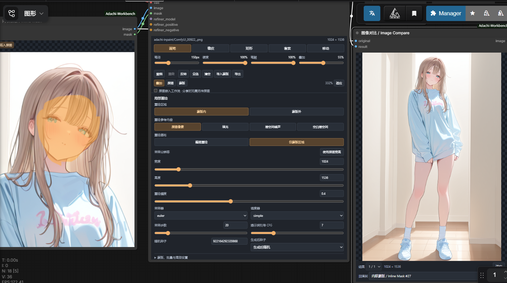
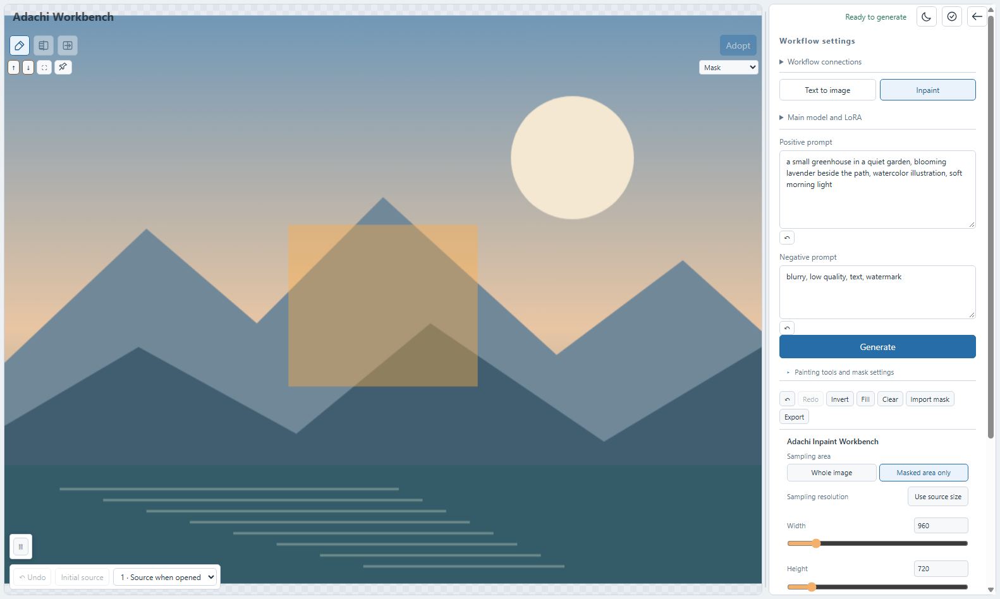
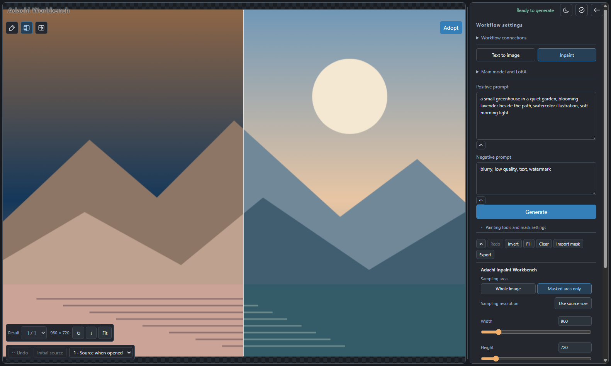
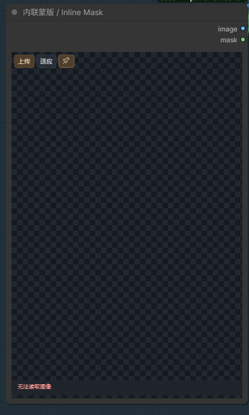
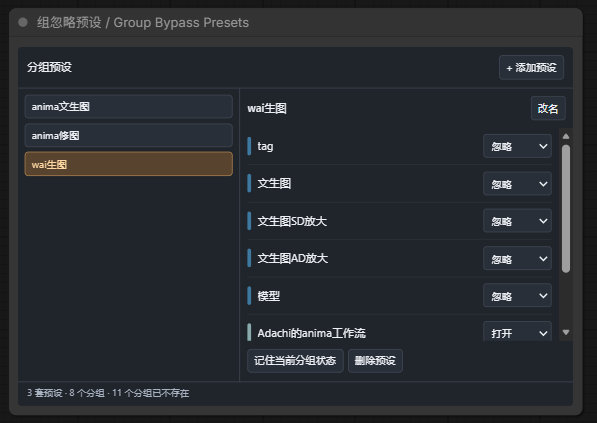
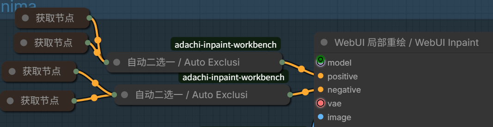
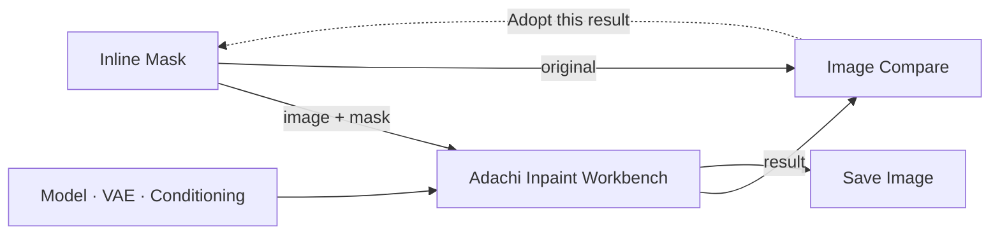

<div align="center">

# Adachi-Inpaint-Workbench

**Paint. Inpaint. Compare. Keep going.**

An inline inpainting workspace for ComfyUI, with WebUI-style controls and tools for switching workflow branches.

**English** · [简体中文](README.zh-CN.md)

[](LICENSE)
[](https://github.com/Comfy-Org/ComfyUI)
[](pyproject.toml)
[](https://github.com/adachi0130/Adachi-Inpaint-Workbench/actions/workflows/ci.yml)

[Features](#features) · [Installation](#installation) · [Quick start](#quick-start) · [Node reference](#node-reference) · [Examples](#example-workflows)



*The original workbench preview. Earlier toolbar screenshots are retained below; v0.6 uses arrow / fit / pin icons.*

</div>

## Why this workbench?

Inpainting usually means moving between the workflow, a mask editor and the generated result. This pack keeps that loop on the graph: paint directly on a node, generate, compare, then adopt a result as your next source **without losing the painted mask**.

| Tool | What it adds |
| --- | --- |
| **Inline Mask** | Paint masks or crop, inpaint and blend two layers in the same node. |
| **Adachi Inpaint Workbench** | Whole-image or masked-area sampling, familiar inpainting controls and compositing back at the source resolution. |
| **Image Compare** | Hover comparison, result history and one-click adoption for another editing round. |
| **Group Bypass Presets** | Save combinations of enabled/bypassed groups and apply them with one click. |
| **Auto Exclusive Switch** | Route the only enabled branch to a shared output, without a manual switch widget. |

English and Simplified Chinese interfaces follow the ComfyUI language setting. The plugin uses the PyTorch, NumPy and Pillow already available in ComfyUI; no extra frontend build is required.

## Features

<details open>
<summary>Workbench screenshots</summary>





*Screenshots captured from the running plugin using a synthetic illustration. The comparison result is a CPU color inversion to demonstrate the divider, not an AI-generated inpaint.*

</details>

### Adachi Workbench · light and dark themes

Click **Open Adachi Workbench** on an Adachi Inpaint Workbench node. Workflows need the plugin’s Inline Mask, inpaint and Image Compare nodes; their IDs, titles, preset names and model filenames can be different. The workspace follows the selected node’s actual connections to its editor and result. If several candidates are ambiguous, choose them under **Workflow connections**. An enabled Group Bypass Presets node supplies its own preset buttons; missing or ambiguous controllers show a reminder.

Models, VAE, text encoders and prompts are discovered from the native execution graph, including Get/Set, Use Everywhere broadcasts and subgraph execution IDs. Intermediate model patches, ControlNet, multiple conditioning encoders, image processing and result postprocessing remain connected. Recognizable components get editing controls; other custom processing remains under the workflow’s control. No personal template IDs or model-family name matching are used.

New profiles inherit the workflow’s LoRA chains, including different positive/negative CLIP paths. Clear **Inherit workflow LoRAs** to use a custom list; an empty custom list disables recognized LoRAs. Custom LoRAs can also be applied when the editable graph has no LoRA loader. Refiner use is available in the model menu. Existing explicit workspace selections remain stored per preset.

Drag the divider between the image and settings to resize them. The width is remembered; double-click resets it, and arrow keys make small adjustments. Narrow screens keep the stacked layout. The theme icon remembers the light/dark preference. Hover controls for help.

The Generate button, width, height and denoise controls are near the top of the settings panel. Collapse the positive and negative prompt sections when you need more room.

Generation shows actual workflow stages and sampler steps above settings. You can keep painting, zooming and changing parameters; the queued task uses its submitted snapshot. Generated results open sliding comparison without replacing the source. Use the single before/after icon to toggle images, the pencil to edit, and **Adopt** to adopt. Crop adoption returns to editing with its region and mask intact. Source history can restore previous images, masks and crop state for the loaded browser session.

In the standalone workspace's sliding and before/after comparison views, scroll over the image to zoom, drag with the middle mouse button to pan, and use **Fit** to restore the fitted view. The workflow's Image Compare node continues to use the wheel for navigating the workflow canvas.

The comparison node and workspace recover lost execution notifications by queued task ID. Image loading reports actual received bytes, a percentage when size is known, then decoding; transient failures retry and can resume after reconnecting. Expired server-side previews require another run. Recovery does not create preview files. Updating backend code requires a full ComfyUI restart; frontend-only updates need a hard refresh.

The [official workflow](examples/Adachi-Workbench.json) is a starting point, not a required template. Validation also covers independently built multi-pipeline workflows, changed node IDs and renamed presets. Labels default to English; choose Simplified Chinese in ComfyUI settings for the Chinese interface. Other locales use the English fallback.

### Paint directly on the graph

Upload, drop or paste a source image and paint on **Inline Mask** itself. In Mask mode, uploading an image automatically fills the connected inpaint dimensions; a replacement of the same size keeps the mask, while a different-sized image starts with a fresh mask. Mask strokes stay in the browser and are saved with the workflow; painting does not require a disk save/load round-trip for every stroke.

Use the **✎ color paint** button at the lower left to paint directly on the image in either mode. Choose a color or **Alt + click** the visible image to sample one; **Ctrl + wheel** changes brush size. Color painting uses a separate layer with its own undo and redo, and the painted image becomes the source for subsequent inpainting. Click the button again to return to mask editing.

If browser draft storage is too small, the color layer may be saved as a PNG in ComfyUI's input directory instead of embedded in the workflow. Include that referenced file when moving the workflow to another machine.

While a source image uploads, a progress bar reports the bytes actually sent and then shows when the image is loading. On platforms requiring a special authentication fallback, the indicator stays indeterminate rather than showing an estimated percentage.

- Brush, soft edges, hardness, opacity, pen pressure, temporary erasing and shape tools.
- A compact **↑ upload / ⛶ fit / pin** toolbar, with a mode selector at the upper right. The pin (**Keep**) preserves the current view; use **Fit** first if desired. Plain wheel then navigates the workflow, while `Ctrl` + wheel still changes brush size and `Shift` + wheel changes hardness.
- Resize the editor horizontally or vertically. The pin state and node dimensions survive workflow reload.
- The connected **Adachi Inpaint Workbench** node hosts the painting controls and sampling parameters, leaving more space for the picture. Its painting tools, mask mode and fill content fold behind an arrow; **Undo / Redo / Invert / Fill / Clear / Import / Export** remain visible. Fold state is saved with the workflow.
- Bounded display buffers and cached image/mask compositing reduce redraw cost at large graph zoom; the saved mask retains its source resolution.

<details>
<summary>View the compact toolbar</summary>

<p align="center">
  
</p>

*Toolbar reference supplied by the author; the source preview is unloaded in this screenshot.*

</details>

### Crop and blend in the same node

Choose **Mask** or **Crop & Blend** at the upper right of Inline Mask. Both modes receive images through **Adopt this result** in Image Compare; Inline Mask has no result input socket.

In Crop & Blend mode, choose one of six 64-aligned presets spanning 512–2048 pixels per side, including 1024 × 1536 (or custom dimensions in multiples of 64). The dashed rectangle follows the pointer by its upper-left corner; left-click locks it. The outside is darkened. A new region starts with an empty repaint mask. Paint inside the rectangle; brush and shape operations stay within its bounds. Use **◌ repaint mask** to return to repaint-mask editing. The position stays fixed for repeated passes. Size presets remain editable while locked; changing the preset, orientation or custom dimensions cancels the current selection and returns to pointer placement, merging any adopted layer first. The outline is a pure black dashed rectangle, and locking it automatically fills the connected Inpaint node's width and height from the crop, using the same rules as Use source size.

| Connection | Purpose |
| --- | --- |
| `Inline Mask.image` + `mask` → `Adachi Inpaint Workbench.image` + `mask` | Send the selected crop and its repaint mask. |
| `Inline Mask.image` → `Image Compare.original`; `Adachi Inpaint Workbench.image` → `Image Compare.result` | Compare the crop before adopting it. |
| `Inline Mask.full_image` → `Save Image.images` | Save the current full image with the **adopted** layer stitched in. |

Generate, inspect the result in **Image Compare**, then click **Adopt this result** to return it. There is no feedback wire and generation does not automatically replace the editor image. Use the inpaint node's **image** output for comparison; its `crop` output is the sampling canvas and can have a different size. In the [official workflow](examples/Adachi-Workbench.json), select **Inpaint**, then switch Inline Mask to **Crop & Blend**.

After adoption, the result appears in the selected area and the editor returns to the repaint mask, ready for another pass. Select **◐ blend layers** to paint the layer mask: brush keeps new pixels, **Alt** restores original pixels, and soft edges blend seams. The blend mask is independent of the repaint mask. While editing the blend mask, **hold the right mouse button** to preview the original and release it to return to the workspace. To select a new region, switch to **◌ repaint mask** and right-click (or press Escape); the visible result is merged before the selection is released. Left-click places the next region. The **↶ Undo** button undoes strokes in the active mask. Hover the bottom controls for instructions. For a generated batch, select the desired result in Image Compare before adopting it. A result tagged with an older crop is rejected after selecting another region.

Merging an adopted crop can take time on a slow connection: upload progress is shown while the selection is being released. If the upload fails, the selection remains in place and the operation can be retried.

### Inpaint the whole image or just the masked region

| Sampling area | Behaviour |
| --- | --- |
| **Whole image** · `whole_image` | Resize the full source to the sampling canvas, generate, then composite through the mask. |
| **Only masked** · `only_masked` | Crop the mask bounds with padding and aspect-ratio context, generate at the sampling size, then paste the region back into place. |

Both modes return a final `image` at the **source image's resolution**. Sampling `width` and `height` are independent controls; **Use source size** fills them from the uploaded image, rounded to the sampler's required multiple of 8.

The panel includes mask inside/outside, original/fill/noise/zero-latent content, denoise, sampler, scheduler, steps, CFG and seed. Advanced controls cover blur, growth, extra feathering, batch size and optional Refiner staging.

### Compare, adopt and refine

Move the pointer over **Image Compare**: **result on the left, original on the right**. Leave the picture to see the full result. The divider stays thin, the image stays fitted, and scrolling navigates the workflow background.

Loading errors and timeouts are retried automatically; **↻** reloads the comparison manually. If the temporary memory preview has expired after server restart or cache eviction, run the workflow again.

Results accumulate within an editing round, with the newest selected automatically. Each result retains its matching original; replayed preview notifications are not counted twice.

Use the **↓** button to download the latest generated result at its original resolution, even when an older result is selected in the list. For a batch, it downloads the last image in that batch.

Click **Adopt this result** to replace the inline source while preserving its mask and current-session undo/redo history. The comparison list resets to **1/1**; the next generation starts a new round. Failed adoption leaves the list intact. Adoption never queues a generation automatically.

### Switch entire workflow setups with presets

Save group states for your own setups: text-to-image, inpainting, model variants, ControlNet, upscaling, or any other grouped branches.



Choose a preset on the left, configure **Enabled / Bypassed / Keep current** on the right, or apply it from the node's right-click menu. Use the arrow to collapse or reopen the group details; this preference is saved in the workflow. Presets are stored in the workflow and need no wires or third-party group controller. Missing groups are reported; overlapping groups give the smaller group's setting priority.

### Automatically use the remaining branch

Connect two alternatives to **Auto Exclusive Switch** and bypass one. The remaining enabled branch flows to the shared output, with no `switch` toggle to maintain.



Use it for conditioning, strings, images, masks, models or latents; the two alternatives must use the same data type. Both enabled, or neither available, is an error rather than a silent preference for A.

KJNodes Get/Set routes and reroutes are supported. **Both Gets may stay enabled**: bypassing a branch's corresponding Set or source disables that branch. Workflow-aware server checks also handle saved subgraph output routes when the source node exists in the submitted execution graph.

## Installation

### Git clone

Run from your `ComfyUI/custom_nodes` directory:

```bash
git clone https://github.com/adachi0130/Adachi-Inpaint-Workbench.git
```

**Restart ComfyUI completely, then hard-refresh the browser with `Ctrl+F5`** (`Cmd+Shift+R` on macOS). Search for `Inline Mask`, `Adachi Inpaint Workbench` or `Adachi` in the node menu.

### Other installation options

- **ComfyUI Manager:** search for `Adachi-Inpaint-Workbench` in the Registry-backed Manager. Version availability depends on Registry validation; check the [Registry listing](https://registry.comfy.org/nodes/adachi-inpaint-workbench). You can also use the Manager's Git URL installation option with this repository's URL.
- **ZIP:** [download the repository](https://github.com/adachi0130/Adachi-Inpaint-Workbench/archive/refs/heads/main.zip), extract it, and place the plugin folder at `ComfyUI/custom_nodes/Adachi-Inpaint-Workbench/`. Keep `web/`, `backend.py` and `__init__.py` together.
- **Windows installer:** from the extracted plugin folder, run the following, pointing to the ComfyUI directory containing `main.py`:

```powershell
powershell -ExecutionPolicy Bypass -File .\install.ps1 -ComfyUIPath "D:\ComfyUI_windows_portable\ComfyUI"
```

The installer backs up an existing installation to `user/adachi-workbench-backups/`. It does not restart ComfyUI.

For a Git installation, update with `git pull` inside the plugin folder, then restart ComfyUI and refresh the browser. Keep only one copy of this node pack in `custom_nodes`.

## Quick start

1. Drag [Adachi-Workbench.json](examples/Adachi-Workbench.json) into ComfyUI. Replace **YOUR_CHECKPOINT.safetensors** with your own compatible checkpoint; the template does not download models or require a LoRA.
2. Click **Text to image** in Group Bypass Presets, edit the neutral example prompts, and queue to create an image.
3. Click **Inpaint**. In **Inline Mask**, upload or drop a source image and paint the region to change. **White repaints; black preserves.** Orange is only the on-screen overlay.
4. Set the sampling area, dimensions and denoise in **Adachi Inpaint Workbench**. Queue on the graph, or click **Open Adachi Workbench** to edit in the separate workspace.
5. Compare the output. Adopt a result when you want it to become the next source, and continue editing with the mask intact.



### Essential connections

| From | To |
| --- | --- |
| `Inline Mask.image` / `mask` | `Adachi Inpaint Workbench.image` / `mask` |
| Your model / VAE / positive / negative conditioning | The matching inputs of `Adachi Inpaint Workbench` |
| `Inline Mask.image` | `Image Compare.original` |
| `Adachi Inpaint Workbench.image` | `Image Compare.result` and/or `Save Image.images` |

The Refiner inputs are optional. Leave them disconnected unless you are using a compatible second-stage model.

## Node reference

All nodes live under **Adachi-Inpaint-Workbench**. The group preset controller is frontend-only; the other six are user-facing backend nodes.

| Node | Purpose | Outputs |
| --- | --- | --- |
| **Inline Mask** | Mask painting or crop/inpaint/layer blending | `image`, `mask`, `full_image` |
| **Adachi Inpaint Workbench** | Prepare, sample and composite in one node | `image` = full composite; `crop` = sampling canvas; `mask` = sampling mask |
| **Image Compare** | Preview, compare and adopt results | `image` = unchanged result batch |
| **Group Bypass Presets** | Apply saved group states | No connections needed |
| **Auto Exclusive Switch** | Forward exactly one enabled alternative | `output` of the selected type |
| **Inpaint Prepare** | Crop/resize pixels and mask for a custom sampler workflow | `pixels`, `mask`, `context` |
| **Inpaint Composite** | Return a decoded local result to source coordinates | `image` |

For modular sampling: `Prepare.pixels → VAE Encode → Set Latent Noise Mask → sampler → VAE Decode → Composite`. Connect `Prepare.mask` to the latent mask node and **always connect `Prepare.context` to `Composite.context`**.

## Canvas shortcuts

| Action | Shortcut / control |
| --- | --- |
| Brush / eraser / rectangle / lasso | `B` / `E` / `R` / `L` |
| Temporary eraser | Hold `Alt`; release to return to the previous tool |
| Brush size | `Ctrl` + wheel, or `[` / `]` |
| Brush hardness | `Shift` + wheel |
| Preview original while blending | In **◐ blend layers**, hold right mouse button; release to restore the workspace |
| Release crop selection | In **◌ repaint mask**, right-click or press Escape; left-click to select a new region |
| Undo / redo | `Ctrl+Z` / `Ctrl+Shift+Z`, or `Ctrl+Y` |
| Image zoom / pan, when unpinned | Wheel / Space + drag, middle-button drag, or the pan tool (`H`) |
| Keep the current view | Fit first if desired, then use the pin; click again to unlock |
| Adjust editor height | Drag the bottom `↕` handle |

The painting panel also provides invert, fill, clear, PNG mask import/export, image/mask/overlay views and **Embed source in workflow**. Overlay opacity affects display only. Scrolling over buttons and parameter controls navigates the outer workflow; a gesture starting on the workflow keeps navigating it when the pointer crosses the picture.

## Example workflows

Use the single [official template: Adachi-Workbench.json](examples/Adachi-Workbench.json). It includes text-to-image and inpainting branches, a shared checkpoint, Group Bypass Presets, automatic exclusive conditioning/image selection, comparison and saving. The preset controller stays outside the groups it controls. Select one preset at a time; enabling both branches intentionally fails exclusive selection.

All example labels are English. Prompts are newly written neutral examples; the checkpoint is a placeholder for your own model. Inpaint requires uploading a source first. Crop & Blend uses the same connected editor, so no second workflow is needed. For model families with separate model, text encoder and VAE loaders, replace the checkpoint block with compatible loaders and connect the matching outputs.

## Model and workflow compatibility

The inpaint node uses ComfyUI `MODEL`, `CONDITIONING`, `VAE`, image and mask inputs with `common_ksampler`. Matching interfaces alone do not establish compatibility with a model's required conditioning, sampler, latent format or reference-image pipeline. Use a matched model, encoder and VAE; the **inpaint_model** switch is for compatible dedicated inpainting architectures.

| Family / case | Evidence | What remains unverified |
| --- | --- | --- |
| WAI (SDXL-based) | End-to-end 512×512 generation without LoRA, including two- and six-step runs; template text-to-image and inpaint branches both ran. | This does not establish support for every SDXL checkpoint, LoRA or extension. |
| SD 1.5 | Workflow validation plus real checkpoint VAE encode/decode and masked compositing on CPU; `[1,4,8,8]` latent. | The sampler was mocked in the VAE test; a full diffusion generation has not been verified. |
| Anima / Wan-derived image VAE | Single-frame 5D latents and a real, randomly initialized Wan VAE were exercised. The user reported a remote workflow running after moving the CLIP encoder out of a subgraph. | No independently reproducible end-to-end run with real Anima weights was available in this audit. |
| FLUX, SD3, Qwen and other families | Not verified. | Their model-specific conditioning, guidance, sampling, reference-image and VAE requirements may need separate workflow nodes; compatibility cannot be assumed. |

Only still-image 4D latents and single-frame 5D `[B,C,1,H,W]` latents are supported; multi-frame video is rejected. To try a different model, first run its normal ComfyUI workflow, connect its matching model/conditioning/VAE to the inpaint node, start with **inpaint_model** off unless the architecture requires it, and check the protected pixels and output resolution. Start with a small image and few steps.

The standalone page requires this plugin's **Inline Mask**, **Adachi Inpaint Workbench** and **Image Compare** nodes. It follows supported connections, Get/Set, Use Everywhere and subgraph execution IDs, and preserves intermediate processing in the tested pipelines. Unknown custom loaders, LoRA classes, prompt fields or virtual routes may remain controlled by the workflow rather than being editable in the page; custom LoRA override cannot be guaranteed for unrecognized loaders. Select explicit nodes under **Workflow connections** when discovery is ambiguous and inspect the result for complex graphs. The page validates and runs the chosen comparison output and its dependencies: unrelated `Save Image` or other output branches do not automatically run there; queue the original workflow when those outputs are needed.

Group presets capture group-level enabled/bypassed states, not every node's individual mixed or muted state. Masks are embedded in saved workflows, while source images and unmerged crop layers normally reference files under `input/`; move those files too, or embed/merge before sharing. Source undo history is limited to the current browser session. Comparison previews are process-local and may expire on eviction or server restart; deployments with multiple backend instances need requests to reach the same instance. Local network-failure simulations passed, but a long-running real cloud soak test has not been performed. For crop/blend and source-history operations, use HTTPS or localhost: the browser's `crypto.randomUUID()` is unavailable in insecure contexts such as many plain-HTTP LAN addresses.

## Compatibility and important behaviour

- **Static images:** ordinary 4D `[B,C,H,W]` latents and single-frame 5D `[B,C,1,H,W]` image latents are supported, including the Wan-derived VAE path used by Anima. Supply the model family's matching VAE and conditioning. This is not multi-frame video inpainting.
- **Anima:** for ordinary masked img2img, leave **inpaint_model** disabled. That option is for dedicated inpainting architectures, not a requirement for painting a mask.
- **Source size:** the final composite keeps the source resolution in both sampling areas. Use `crop` or a separate resize node for a target-size output.
- **Crop layers:** the fusion mask and crop coordinates are saved in the workflow; the latest layer is a relative image reference under `input/adachi-inpaint-layers/`. Include that file when moving an unmerged edit between machines, or merge layers and embed the source first.
- **Sharing:** masks are embedded in saved workflows. Source images use a relative `input/` path by default; enable **Embed source in workflow** to include the picture too. Embedded images increase JSON size. If an embedded source would exceed browser draft storage when loading a workflow, uploading an image, changing modes or enabling embedding, the plugin first uploads an exact source copy and switches to an input-file reference, preserving masks and layers. To intentionally keep a very large source embedded, disable ComfyUI browser workflow persistence before embedding; exported files are not subject to the browser draft quota. If the page already reports draft failures on every edit, save with **Ctrl+S**, then reload with **Ctrl+F5** to reset ComfyUI's disabled draft-storage state.
- **Adoption:** source and result dimensions must match to preserve mask coordinates. Undo/redo commands survive adoption in the current session; saving/reloading retains the mask, not the command history.
- **Comparison previews:** new originals and results are held in server memory instead of temporary image files. The default cache is 512 MiB and at most 512 comparison batches; set `ADACHI_COMPARE_MEMORY_MIB` to 64–4096 before starting ComfyUI to change it. Cache eviction or server restart expires old comparisons and their download references; rerun the workflow to refresh them. A single batch larger than the limit reports an error. Previous disk-based preview references remain supported while available, and expired old plugin preview files are still cleaned up. Images adopted into the editor are saved separately under `input/adachi-inpaint/` or `input/adachi-inpaint-layers/`.
- **Scope:** this is an original WebUI-style implementation. It does not promise identical WebUI pixels, scripts or extension behaviour. Extra soft-edge feathering is not WebUI's full Soft Inpainting algorithm.

<details>
<summary>Sampling, fill and batch details</summary>

- Sampling dimensions use multiples of 8. Padding, blur and mask growth are measured in source pixels; effective mask edges can change after blur/growth, while pixels with zero effective mask remain unchanged.
- `mask_mode=outside` inverts the painted region before mask processing.
- `resize_mode` controls whole-image resizing. Masked-area mode uses an aspect-preserving transform that retains the full mask, including at source edges.
- Fill modes: **original**, surrounding-colour **fill**, **latent noise**, and **zero latent**. The latent modes belong to Adachi Inpaint Workbench; the modular Prepare node handles pixels and masks.
- An empty mask or `denoise=0` skips VAE/sampling. `batch_size` is variants per input image, not ComfyUI queue count.
- For modular multi-source batches, group variants per source (`A,A,B,B`), rather than interleaving them (`A,B,A,B`).
- Optional Refiner uses `refiner_model` and `refiner_switch`; `0.8` runs the last 20% with the Refiner. Compatible Refiner conditioning is recommended. A switch of `1` uses only the base model; `0` uses only the Refiner.
- Input limits: 64 MiB per file, 32 megapixels and 16384 pixels per image edge. Large-image painting and PNG encoding still depend on browser memory and hardware.

</details>

## Troubleshooting and development

**Old UI after updating?** Fully restart ComfyUI and hard-refresh the browser. Backend Python changes need a server restart; refreshing the page alone is insufficient.

**Exclusive switch reports no enabled input?** Check the real source and corresponding Set, not only the visible Get nodes. Keep the selector outside the groups it controls. If an integration still drops a subgraph output, placing the CLIP encoder outside that subgraph is a practical workaround. For a report, include the workflow, plugin/frontend versions and full error text; current errors show frontend, workflow and submitted-input flags.

**An image is missing after opening someone else's workflow?** Supply the source at its relative input path, or have the sender save with source embedding enabled. Expired comparison previews require regeneration.

CPU regression tests:

```bash
python -m unittest discover -s tests -v
node --experimental-default-type=module tests/test_exclusive_routes.mjs
node --experimental-default-type=module tests/test_compare_history.mjs
```

See [verification notes](VERIFICATION.md) for tested configurations and limits, [changelog](CHANGELOG.md) for updates, and [rollback instructions](ROLLBACK.md) for returning to an earlier version. Model-family and image-quality coverage is not exhaustive.

## Release history

| Versions | Highlights and fixes |
| --- | --- |
| 2.1.1 | Streamlined comparison Fit controls, moved repaint-area choices below Generate, and combined color-paint controls with the lower toolbar. |
| 2.1.0 | Color-paint layer, crop merge progress, workspace comparison zoom, reordered controls, collapsible prompts and GPL-3.0-only licensing. |
| 2.0.1 | Weak-network retry and cancellation, preview resource cleanup, rollback races, dense-mask memory reduction and safer malformed-workflow handling. |
| 2.0.0 | Standalone light/dark workbench, workflow discovery, editable generation, task progress, result recovery and unified template. |
| 1.0.1 / 1.0.0 / 0.9 | Stable release; preview reload/retry, in-memory comparisons and real upload progress. |
| 0.8 | Crop adoption and dimension sync, latest-result download, different-sized upload refresh. |
| 0.7 | Preserve masks on replacement, source download and pin-current-view behavior. |
| 0.6 | Inline crop/blend, locked selection and dimension sync, right-click preview/reselection and draft recovery; magic wand and quick selection were later removed. |
| 0.5 | Group presets and automatic exclusive switch, mask retention, 5D image VAE support and canvas performance fixes. |
| 0.4 / 0.3 / 0.2 | Inline controls and vertical resizing, comparison/adoption, temporary eraser and bilingual node UI. |

The [complete changelog](CHANGELOG.md) lists individual releases and fixes.

## Credits and license

Created by **Adachi / 安达**. The current project is licensed under [GNU GPL-3.0-only](LICENSE). You may use it commercially; when distributing the covered program or modifications, follow GPL-3.0 source and license requirements. Releases through v2.0.1 were distributed under MIT; recipients retain those earlier permissions. The original copyright and license notice is preserved in [LICENSES](LICENSES/MIT-previous-releases.txt). The current branch's GPL terms do not retroactively revoke the earlier MIT grant.

Built for [ComfyUI](https://github.com/Comfy-Org/ComfyUI), with familiar inpainting controls inspired by WebUI and hover-comparison interaction inspired by [rgthree-comfy](https://github.com/rgthree/rgthree-comfy). This repository contains its own implementation; those projects are not bundled dependencies.

Bug reports and workflow examples are welcome in [Issues](https://github.com/adachi0130/Adachi-Inpaint-Workbench/issues).
