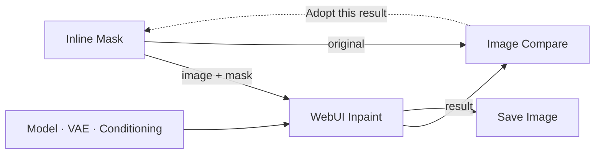

<div align="center">

# Adachi-Inpaint-Workbench

**Paint. Inpaint. Compare. Keep going.**

An inline inpainting workspace for ComfyUI, with WebUI-style controls and tools for switching workflow branches.

**English** · [简体中文](README.zh-CN.md)

[](LICENSE)
[](https://github.com/Comfy-Org/ComfyUI)
[](pyproject.toml)
[](https://github.com/adachi0130/Adachi-Inpaint-Workbench/actions/workflows/ci.yml)

[Features](#features) · [Installation](#installation) · [Quick start](#quick-start) · [Node reference](#node-reference) · [Examples](#example-workflows)


*The original workbench preview. The compact Upload / Fit / pin toolbar is shown below.*

</div>

## Why this workbench?

Inpainting usually means moving between the workflow, a mask editor and the generated result. This pack keeps that loop on the graph: paint directly on a node, generate, compare, then adopt a result as your next source **without losing the painted mask**.

| Tool | What it adds |
| --- | --- |
| **Inline Mask** | Paint in the workflow, with brush, eraser, rectangle, lasso and undo/redo. |
| **WebUI Inpaint** | Whole-image or masked-area sampling, familiar inpainting controls and compositing back at the source resolution. |
| **Image Compare** | Hover comparison, result history and one-click adoption for another editing round. |
| **Group Bypass Presets** | Save combinations of enabled/bypassed groups and apply them with one click. |
| **Auto Exclusive Switch** | Route the only enabled branch to a shared output, without a manual switch widget. |

English and Simplified Chinese interfaces follow the ComfyUI language setting. The plugin uses the PyTorch, NumPy and Pillow already available in ComfyUI; no extra frontend build is required.

## Features

### Paint directly on the graph

Upload, drop or paste a source image and paint on **Inline Mask** itself. Mask strokes stay in the browser and are saved with the workflow; painting does not require a disk save/load round-trip for every stroke.

- Brush, soft edges, hardness, opacity, pen pressure, temporary erasing and shape tools.
- A compact **Upload / Fit / pin** toolbar. Enable the pin (**Keep**) to keep the image fitted and centered; plain wheel then navigates the workflow, while `Ctrl` + wheel still changes brush size.
- Resize the editor horizontally or vertically. The pin state and node dimensions survive workflow reload.
- The connected **WebUI Inpaint** node hosts the painting controls and sampling parameters, leaving more space for the picture.
- Bounded display buffers and cached image/mask compositing reduce redraw cost at large graph zoom; the saved mask retains its source resolution.

<details>
<summary>View the compact toolbar</summary>

<p align="center">
  
</p>

*Toolbar reference supplied by the author; the source preview is unloaded in this screenshot.*

</details>

### Inpaint the whole image or just the masked region

| Sampling area | Behaviour |
| --- | --- |
| **Whole image** · `whole_image` | Resize the full source to the sampling canvas, generate, then composite through the mask. |
| **Only masked** · `only_masked` | Crop the mask bounds with padding and aspect-ratio context, generate at the sampling size, then paste the region back into place. |

Both modes return a final `image` at the **source image's resolution**. Sampling `width` and `height` are independent controls; **Use source size** fills them from the uploaded image, rounded to the sampler's required multiple of 8.

The panel includes mask inside/outside, original/fill/noise/zero-latent content, denoise, sampler, scheduler, steps, CFG and seed. Advanced controls cover blur, growth, extra feathering, batch size and optional Refiner staging.

### Compare, adopt and refine

Move the pointer over **Image Compare**: **result on the left, original on the right**. Leave the picture to see the full result. The divider stays thin, the image stays fitted, and scrolling navigates the workflow background.

Results accumulate within an editing round, with the newest selected automatically. Each result retains its matching original; replayed preview notifications are not counted twice.

Click **Adopt this result** to replace the inline source while preserving its mask and current-session undo/redo history. The comparison list resets to **1/1**; the next generation starts a new round. Failed adoption leaves the list intact. Adoption never queues a generation automatically.

### Switch entire workflow setups with presets

Save group states for your own setups: text-to-image, inpainting, model variants, ControlNet, upscaling, or any other grouped branches.


Choose a preset on the left, configure **Enabled / Bypassed / Keep current** on the right, or apply it from the node's right-click menu. Presets are stored in the workflow and need no wires or third-party group controller. Missing groups are reported; overlapping groups give the smaller group's setting priority.

### Automatically use the remaining branch

Connect two alternatives to **Auto Exclusive Switch** and bypass one. The remaining enabled branch flows to the shared output, with no `switch` toggle to maintain.


Use it for conditioning, strings, images, masks, models or latents; the two alternatives must use the same data type. Both enabled, or neither available, is an error rather than a silent preference for A.

KJNodes Get/Set routes and reroutes are supported. **Both Gets may stay enabled**: bypassing a branch's corresponding Set or source disables that branch. Workflow-aware server checks also handle saved subgraph output routes when the source node exists in the submitted execution graph.

## Installation

### Git clone

Run from your `ComfyUI/custom_nodes` directory:

```bash
git clone https://github.com/adachi0130/Adachi-Inpaint-Workbench.git
```

**Restart ComfyUI completely, then hard-refresh the browser with `Ctrl+F5`** (`Cmd+Shift+R` on macOS). Search for `Inline Mask`, `WebUI Inpaint` or `Adachi` in the node menu.

### Other installation options

- **ComfyUI Manager:** use its Git URL installation option, if available, with this repository's URL. Git URL installation and visibility in Manager's search index are separate; see the [publishing notes](registry/README.md).
- **ZIP:** [download the repository](https://github.com/adachi0130/Adachi-Inpaint-Workbench/archive/refs/heads/main.zip), extract it, and place the plugin folder at `ComfyUI/custom_nodes/Adachi-Inpaint-Workbench/`. Keep `web/`, `backend.py` and `__init__.py` together.
- **Windows installer:** from the extracted plugin folder, run the following, pointing to the ComfyUI directory containing `main.py`:

```powershell
powershell -ExecutionPolicy Bypass -File .\install.ps1 -ComfyUIPath "D:\ComfyUI_windows_portable\ComfyUI"
```

The installer backs up an existing installation to `user/adachi-workbench-backups/`. It does not restart ComfyUI.

For a Git installation, update with `git pull` inside the plugin folder, then restart ComfyUI and refresh the browser. Keep only one copy of this node pack in `custom_nodes`.

## Quick start

1. Drag [01-inline-inpaint.json](examples/01-inline-inpaint.json) into ComfyUI and select a compatible checkpoint, or connect your existing model, VAE and conditioning nodes.
2. In **Inline Mask**, upload a picture and paint the region to change. **White repaints; black preserves.** Orange is only the on-screen overlay.
3. Edit the upstream positive/negative prompts. Set the sampling area, width, height and denoise in **WebUI Inpaint**, then queue the workflow.
4. Compare the output. Adopt a result when you want it to become the next source, and continue editing with the mask intact.



### Essential connections

| From | To |
| --- | --- |
| `Inline Mask.image` / `mask` | `WebUI Inpaint.image` / `mask` |
| Your model / VAE / positive / negative conditioning | The matching inputs of `WebUI Inpaint` |
| `Inline Mask.image` | `Image Compare.original` |
| `WebUI Inpaint.image` | `Image Compare.result` and/or `Save Image.images` |

The Refiner inputs are optional. Leave them disconnected unless you are using a compatible second-stage model.

## Node reference

All nodes live under **Adachi-Inpaint-Workbench**. The group preset controller is frontend-only; the other six have backend node classes.

| Node | Purpose | Outputs |
| --- | --- | --- |
| **Inline Mask** | Source image and inline mask editing | `image`, `mask` |
| **WebUI Inpaint** | Prepare, sample and composite in one node | `image` = full composite; `crop` = sampling canvas; `mask` = sampling mask |
| **Image Compare** | Preview, compare and adopt results | `image` = unchanged result batch |
| **Group Bypass Presets** | Apply saved group states | No connections needed |
| **Auto Exclusive Switch** | Forward exactly one enabled alternative | `output` of the selected type |
| **Inpaint Prepare** | Crop/resize pixels and mask for a custom sampler workflow | `pixels`, `mask`, `context` |
| **Inpaint Composite** | Return a decoded local result to source coordinates | `image` |

For modular sampling: `Prepare.pixels → VAE Encode → Set Latent Noise Mask → sampler → VAE Decode → Composite`. Connect `Prepare.mask` to the latent mask node and **always connect `Prepare.context` to `Composite.context`**. See the [modular example](examples/02-modular-inpaint.json).

## Canvas shortcuts

| Action | Shortcut / control |
| --- | --- |
| Brush / eraser / rectangle / lasso | `B` / `E` / `R` / `L` |
| Temporary eraser | Hold `Alt`, or use the right mouse button; release to return to the previous tool |
| Brush size | `Ctrl` + wheel, or `[` / `]` |
| Undo / redo | `Ctrl+Z` / `Ctrl+Shift+Z`, or `Ctrl+Y` |
| Image zoom / pan, when unpinned | Wheel / Space + drag, middle-button drag, or the pan tool (`H`) |
| Keep the image fitted | Pin beside **Fit**; click again to unlock |
| Adjust editor height | Drag the bottom `↕` handle |

The painting panel also provides invert, fill, clear, PNG mask import/export, image/mask/overlay views and **Embed source in workflow**. Overlay opacity affects display only. Scrolling over buttons and parameter controls navigates the outer workflow; a gesture starting on the workflow keeps navigating it when the pointer crosses the picture.

## Example workflows

Drag a JSON file into ComfyUI:

| Example | What to try |
| --- | --- |
| [01 · Inline inpainting](examples/01-inline-inpaint.json) | The complete painting and inpainting loop; select your own compatible checkpoint. |
| [02 · Modular inpainting](examples/02-modular-inpaint.json) | Use standard encode/sample/decode nodes with Prepare and Composite. |
| [03 · Group presets](examples/03-group-presets.json) | Model-free preset switching with image branches. |
| [04 · Exclusive switch](examples/04-exclusive-switch.json) | Model-free A/B selection controlled by group presets. |

## Compatibility and important behaviour

- **Static images:** ordinary 4D `[B,C,H,W]` latents and single-frame 5D `[B,C,1,H,W]` image latents are supported, including the Wan-derived VAE path used by Anima. Supply the model family's matching VAE and conditioning. This is not multi-frame video inpainting.
- **Anima:** for ordinary masked img2img, leave **inpaint_model** disabled. That option is for dedicated inpainting architectures, not a requirement for painting a mask.
- **Source size:** the final composite keeps the source resolution in both sampling areas. Use `crop` or a separate resize node for a target-size output.
- **Sharing:** masks are embedded in saved workflows. Source images use a relative `input/` path by default; enable **Embed source in workflow** to include the picture too. Embedded images increase JSON size.
- **Adoption:** source and result dimensions must match to preserve mask coordinates. Undo/redo commands survive adoption in the current session; saving/reloading retains the mask, not the command history.
- **Temporary previews:** comparison history stores preview references. ComfyUI temp cleanup may expire them; adopted images are stored under `input/adachi-inpaint/`.
- **Scope:** this is an original WebUI-style implementation. It does not promise identical WebUI pixels, scripts or extension behaviour. Extra soft-edge feathering is not WebUI's full Soft Inpainting algorithm.

<details>
<summary>Sampling, fill and batch details</summary>

- Sampling dimensions use multiples of 8. Padding, blur and mask growth are measured in source pixels; effective mask edges can change after blur/growth, while pixels with zero effective mask remain unchanged.
- `mask_mode=outside` inverts the painted region before mask processing.
- `resize_mode` controls whole-image resizing. Masked-area mode uses an aspect-preserving transform that retains the full mask, including at source edges.
- Fill modes: **original**, surrounding-colour **fill**, **latent noise**, and **zero latent**. The latent modes belong to WebUI Inpaint; the modular Prepare node handles pixels and masks.
- An empty mask or `denoise=0` skips VAE/sampling. `batch_size` is variants per input image, not ComfyUI queue count.
- For modular multi-source batches, group variants per source (`A,A,B,B`), rather than interleaving them (`A,B,A,B`).
- Optional Refiner uses `refiner_model` and `refiner_switch`; `0.8` runs the last 20% with the Refiner. Compatible Refiner conditioning is recommended. A switch of `1` uses only the base model; `0` uses only the Refiner.
- Input limits: 64 MiB per file, 32 megapixels and 16384 pixels per image edge. Large-image painting and PNG encoding still depend on browser memory and hardware.

</details>

## Troubleshooting and development

**Old UI after updating?** Fully restart ComfyUI and hard-refresh the browser. Backend Python changes need a server restart; refreshing the page alone is insufficient.

**Exclusive switch reports no enabled input?** Check the real source and corresponding Set, not only the visible Get nodes. Keep the selector outside the groups it controls. If an integration still drops a subgraph output, placing the CLIP encoder outside that subgraph is a practical workaround. For a report, include the workflow, plugin/frontend versions and full error text; current errors show frontend, workflow and submitted-input flags.

**An image is missing after opening someone else's workflow?** Supply the source at its relative input path, or have the sender save with source embedding enabled. Expired comparison previews require regeneration.

CPU regression tests:

```bash
python -m unittest discover -s tests -v
node --experimental-default-type=module tests/test_exclusive_routes.mjs
node --experimental-default-type=module tests/test_compare_history.mjs
```

See [verification notes](VERIFICATION.md) for tested configurations and limits, [changelog](CHANGELOG.md) for updates, and [rollback instructions](ROLLBACK.md) for returning to an earlier version. Model-family and image-quality coverage is not exhaustive.

## Credits and license

Created by **Adachi / 安达**. Licensed under [MIT](LICENSE).

Built for [ComfyUI](https://github.com/Comfy-Org/ComfyUI), with familiar inpainting controls inspired by WebUI and hover-comparison interaction inspired by [rgthree-comfy](https://github.com/rgthree/rgthree-comfy). This repository contains its own implementation; those projects are not bundled dependencies.

Bug reports and workflow examples are welcome in [Issues](https://github.com/adachi0130/Adachi-Inpaint-Workbench/issues).
