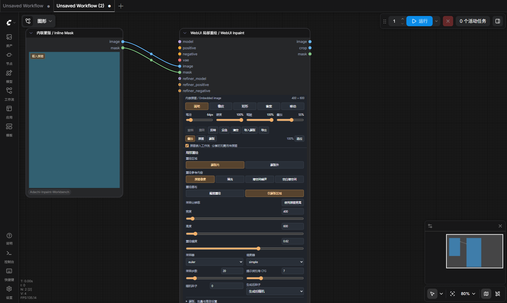

# Adachi-Inpaint-Workbench

直接在 ComfyUI 工作流节点里载入原图、涂抹蒙版、局部重绘，无需另开遮罩编辑器喵。



由 Adachi（安达）开发，MIT 开源喵。
支持整图范围与蒙版范围重绘、Alt 临时橡皮擦、Ctrl+滚轮笔径、图像对比及一键采用重绘结果喵。

## ComfyUI Manager 与安装

Manager 的 Git URL 安装可使用 `https://github.com/adachi0130/Adachi-Inpaint-Workbench`；或在 `ComfyUI/custom_nodes` 中克隆喵。

```bash
git clone https://github.com/adachi0130/Adachi-Inpaint-Workbench.git
```

Manager 搜索收录需要其维护者合并节点清单申请；仅有 GitHub 仓库不会立即出现在搜索结果中喵。
当前尚未配置 Comfy Registry 发布者，Registry 发布流程见 [发布说明](registry/README.md) 喵。

## 安装

将整个 `Adachi-Inpaint-Workbench` 文件夹复制到 `ComfyUI/custom_nodes/`，保留其中的 `web/`、`backend.py`、`__init__.py` 喵。
重启 ComfyUI，然后在浏览器按 `Ctrl+F5` 刷新前端缓存喵。
在节点搜索中输入 `Inline Mask` 或 `WebUI Inpaint`，分类是 **安达工作台 / Adachi-Inpaint-Workbench** 喵。

Windows 也可以从解压后的插件文件夹运行安装脚本，将参数改为自己的、包含 `main.py` 的 ComfyUI 目录喵。

```powershell
powershell -ExecutionPolicy Bypass -File .\install.ps1 -ComfyUIPath "D:\ComfyUI_windows_portable\ComfyUI"
```

脚本只复制本插件；更新时会把旧插件压缩备份到所选 ComfyUI 的 `user/adachi-workbench-backups/`，不会自动重启服务喵。
插件使用 ComfyUI 已有的 PyTorch、NumPy、Pillow，不需要额外 pip/npm 安装喵。
卸载时关闭 ComfyUI，再删除 `custom_nodes/Adachi-Inpaint-Workbench` 即可喵。

## 最快上手

1. 将 `examples/01-inline-inpaint.json` 拖入 ComfyUI，选择自己的 checkpoint 喵。
2. 在 **内联蒙版 / Inline Mask** 节点载入、拖放或粘贴图片，直接在画布上涂抹需要重绘的部分喵。
3. 修改正负提示词，在 **WebUI 局部重绘** 节点中选择画笔工具、重绘范围、采样分辨率、采样器与重绘幅度，然后运行喵。
4. `image` 输出回贴后的完整原图，`crop` 输出实际采样画布，`mask` 输出该采样画布对应的蒙版喵。

**白色蒙版重绘，黑色保护；画布中橙色代表绘制区域** 喵。
当 `mask_mode=outside` 时会反相，重绘橙色之外的部分喵。
`mask_blur`、`mask_grow`、额外羽化会改变有效蒙版边界，边界内的混合像素也会变化；有效蒙版为零的像素逐值保留喵。

## 两种重绘范围

| `area` | 对应操作 | 实际行为 |
|---|---|---|
| `whole_image` | 以原图范围重绘 | 将整张图缩放到 `width × height` 采样，再按照蒙版回贴原图 |
| `only_masked` | 以蒙版范围重绘 | 取蒙版包围框，加 `padding` 上下文，尽量扩展到目标比例，将局部放大到采样尺寸，生成后贴回原位置 |

`width/height` 指采样画布尺寸，须为 8 的倍数；两种模式的最终 `image` 都保持上传原图的分辨率喵。
这一点与 WebUI 整图模式常以目标宽高输出的行为有区别；需要目标尺寸的图时，可取 `crop`，或在完整输出后连接缩放节点喵。
`padding`、`mask_blur`、`mask_grow` 的单位都是原图像素喵。
蒙版贴近图像边缘时，局部模式用保比例填充保住整块蒙版，不会为匹配比例切掉蒙版喵。
`resize_mode` 的拉伸、居中裁剪、保比例填充作用于 `whole_image`；局部模式自动采用保留全部蒙版的变换喵。

## 画布操作

| 操作 | 使用方式 |
|---|---|
| 画笔 / 橡皮 | 工具栏切换，`B` / `E`；按住 `Alt` 或鼠标右键临时擦除，松开恢复原工具；擦除时显示橡皮擦图标与淡粉色虚线范围 |
| 矩形 / 自由套索 | `R` / `L`，拖动画出要重绘的区域 |
| 笔径 / 硬度 / 笔触 | 分别控制原图像素笔径、边缘硬度、绘制不透明度 |
| 橙色叠加 | 仅调节显示透明度，不改变真实蒙版 |
| 撤销 / 重做 | `Ctrl+Z` / `Ctrl+Shift+Z`，或 `Ctrl+Y` |
| 缩放 / 移动 | 滚轮缩放；空格拖动、鼠标中键或 `H` 移动；「适应」复位 |
| 笔径快捷键 | `[` / `]` |
| 快速调整笔径 | 鼠标放在画布上，按住 `Ctrl` 向上滚轮增大、向下滚轮减小；普通滚轮仍缩放图片 |
| 编辑器高度 | 拖动编辑器底部 `↕` 条上下拉伸；尺寸随工作流保存 |
| 反转 / 全选 / 清空 | 作用于当前绘制蒙版，可撤销 |
| 导入 / 导出蒙版 | 原始分辨率 PNG；黑白图按亮度导入，带透明度的图按 alpha 导入 |
| 原图 / 蒙版 / 叠加 | 切换预览，不改变输出 |

支持画笔压力和软笔刷；鼠标使用固定压力喵。
内联蒙版仅保留图片编辑区与左上角的小型 **载入原图** 按钮，载入后按原图比例调整画布高度以减少空边喵。
画笔、橡皮、矩形、套索、移动、四个笔刷滑条、撤销重做、蒙版操作、显示切换、适应与原图嵌入选项，均显示在连接的 **WebUI 局部重绘** 节点中，直接控制原来的内联画布喵。
图片上传一次，之后每笔在浏览器内更新蒙版，并在工作流及运行参数中保存 PNG 数据，无需每画一笔都保存、重新加载磁盘文件喵。
鼠标位于图片区域时滚轮缩放图片；位于工具栏、按钮、滑条或参数面板时，滚轮遵循 ComfyUI 的画布导航设置喵。
从 ComfyUI 画布开始的连续滚轮手势移入图片时，继续导航外部画布；停下后再在图片里滚动才缩放图片喵。
超大图仍会消耗浏览器内存，PNG 编码耗时取决于分辨率和设备，不能保证所有图像都瞬间完成喵。

## 画笔工具与重绘参数

内联蒙版连接 **WebUI 局部重绘** 的 `image` 输入后，原画笔控件自动显示在该重绘节点中；下方参数面板直接控制该节点的真实采样参数喵。
宽度和高度各占一行，支持滑条及数值输入；重绘幅度也使用滑条，点击 **使用原图宽高** 可填入原图尺寸，按采样要求取最近的 8 的倍数喵。
蒙版内外、填充、重绘范围、采样器、调度器、步数、CFG 和种子直接显示，蒙版处理、批量、Refiner 切换等位于 **蒙版、批量与高级设置** 中喵。
如果一张内联原图连接多个重绘节点，画笔控件放在第一个 WebUI 重绘节点中，各节点保留自己的参数面板；断开或删除该节点后，工具自动迁移到下一个可用节点喵。
外部连线控制的参数会禁用对应面板控件；模块化工作流将画笔工具放在 **重绘预处理 / Inpaint Prepare** 节点中，采样参数仍在独立采样节点中调整喵。

## 图像对比与连续重绘

添加 **图像对比 / Image Compare** 节点，将内联蒙版的 `image` 接到 `original`，最终完整重绘图 `image` 接到 `result`，运行后即可对比喵。
鼠标移入图片时，细竖线左边显示重绘结果、右边显示原图；移出后隐藏分割线，完整显示重绘结果，普通滚轮缩放图片；批量结果选择、尺寸和适应按钮位于图片下方喵。
满意后点击 **采用此结果**，插件会把当前选中的结果上传为新的原图，回填到上游内联蒙版，并清空旧蒙版，随后可以继续涂抹下一处喵。
原图连接经过中间 IMAGE 节点时会向上寻找内联蒙版；若存在多个目标，可以在“回填到”中明确选择喵。
回填只在点击按钮时发生，不会自动开始下一轮生成；`image` 输出仍传递整个结果批次，可接保存图像喵。
对比预览保存在 ComfyUI 临时目录，清理或重启后可能需要重新运行；点击采用后的原图保存在 `input/adachi-inpaint/`，不依赖临时预览文件喵。

## 填充、批量与 Refiner

| `fill` | 行为 |
|---|---|
| `original` | 使用原图像素编码 latent |
| `fill` | 按蒙版周围颜色进行多尺度填充，再编码 latent |
| `latent_noise` | 在 masked latent 内填入与 seed 相关的噪声 |
| `latent_nothing` | 将 masked latent 置零 |

后两种 latent 填充由 **WebUI 局部重绘** 一体节点实现；独立 **重绘预处理** 只处理像素与蒙版，使用标准节点组合时请选择 `original` 或 `fill` 喵。
`denoise=0` 与空蒙版会直接返回原图，跳过 VAE 和采样；`batch_size` 为每张输入图的变体数，使用相同 seed 可重现同一批次喵。
多次批量运行可使用 ComfyUI 的队列数量以及 seed 的生成后控制；`batch_size` 控制单次运行数量喵。
普通 SD/SDXL checkpoint 保持 `inpaint_model=false`；专用 inpainting 模型才开启，届时调用 ComfyUI 原生 `InpaintModelConditioning` 喵。

可选接入兼容的 `refiner_model`，用 `refiner_switch` 指定 base 采样步骤占比；`0.8` 表示约前 80% 步骤由 base 执行喵。
建议用 Refiner 自身的 CLIP 编码并接入 `refiner_positive/refiner_negative`，未接入则沿用原条件，VAE 仍使用 base 侧的 VAE 喵。
`refiner_switch=1` 只用 base，`0` 只用 Refiner；已知 latent 格式不兼容时会报错喵。

## 使用标准采样工作流

`examples/02-modular-inpaint.json` 展示可自由更换采样器的连接方式喵。

```text
Inline Mask ── image/mask ──> Inpaint Prepare
                                pixels ──> VAE Encode ──> Set Latent Noise Mask ──> KSampler
                                mask ──────────────────────────┘                      │
                                context ──────────────────────────────────────┐      │
                                                                             │      ▼
                                                                        Inpaint Composite <── VAE Decode
                                                                             │
                                                                          Save Image
```

务必将 `Prepare.context` 接回 **原图回贴 / Inpaint Composite**，这样局部结果会回到原图坐标和尺寸喵。
标准示例针对普通 checkpoint；专用 inpainting checkpoint 应改用其需要的 conditioning 节点，或直接使用一体节点喵。
多个输入图各生成多个变体时，Composite 需要变体按原图分组，例如 `A,A,B,B`；一体节点已按此排列，外部重复 latent 节点如果输出 `A,B,A,B`，需先调整批次顺序喵。

## 分享与兼容性

绘制蒙版自动写入工作流；默认原图只保存 ComfyUI `input/` 内的相对路径喵。
要让别人直接打开同一张图，勾选画布下方 **原图嵌入工作流** 后再保存工作流 JSON；对方安装本插件并选择自己的模型即可继续编辑喵。
不嵌入时，需要一并提供原图，并保持 `input/` 下的相对路径一致喵。
嵌入会增大工作流文件，原图和蒙版也会随工作流分享，因此分享前请确认图片内容喵。

这是原创实现的 WebUI 风格工作流，不承诺与 AUTOMATIC1111/Forge 的结果逐像素一致喵。
`soft_edge` 是额外高斯羽化，`soft_strength` 控制额外半径，**并未复刻 WebUI 的 Soft Inpainting 原算法及其完整参数** 喵。
采样器、调度器和 Refiner 使用当前 ComfyUI 的实现，填充算法也为本插件独立实现喵。
目前支持静态图像与 4 维 latent；不支持视频 VAE、WebUI 脚本/扩展和自动读取 WebUI 插件配置喵。
文件最大 64 MiB、图像最大 3200 万像素、单边最大 16384 像素；不附带模型或下载服务喵。
已在本机 ComfyUI 的隔离 CPU 服务验证节点加载、画布编辑、工作流/运行参数保存与恢复，并用 mock VAE/采样器验证后端；尚未用实际 checkpoint 验证生成质量和各模型家族/Refiner 的兼容性喵。

## English quick start

**Adachi-Inpaint-Workbench** is an MIT-licensed ComfyUI custom node pack for direct mask painting, WebUI-style inpainting, result/original comparison, and adopting results for another edit pass喵.

Copy the entire `Adachi-Inpaint-Workbench` folder into `ComfyUI/custom_nodes`, restart ComfyUI, then hard-refresh your browser喵.
Search for `Inline Mask` or `WebUI Inpaint` under **安达工作台 / Adachi-Inpaint-Workbench**喵.
No extra pip or npm packages are required beyond ComfyUI's PyTorch, NumPy and Pillow喵.

Drag `examples/01-inline-inpaint.json` into ComfyUI, select a checkpoint, upload an image inside **Inline Mask**, paint, and run the workflow喵.
White repaints and black preserves; orange is the visual mask overlay喵.
Use `whole_image` to sample the full source extent, or `only_masked` to enlarge the padded mask bounding box for detailed local inpainting喵.
Sampling uses `width × height`; the final `image` output is composited at the original image resolution in both modes, while `crop` exposes the generated sampling canvas喵.

The editor supports brush/eraser, rectangles, freehand lasso, undo/redo, invert, mask import/export, brush size/hardness/opacity, zoom, pan, drag-and-drop and clipboard images喵.
Inline Mask shows only the image and a small upload button; its original live painting controls and the sampling parameter panel are hosted in the connected WebUI Inpaint node (or Inpaint Prepare for modular workflows)喵.
Paint with the left button; hold Alt or use the right button to erase temporarily, use Ctrl+wheel for brush size, zoom with the plain wheel, and pan while holding Space喵.
Enable **Embed source in workflow** before saving JSON to share the source image along with its mask喵.

The **Image Compare** node takes `original` from Inline Mask and `result` from the final full-size generated image; hover to compare result on the left and original on the right, and leave the picture to see the full result喵.
Select a batch result if needed, then click **采用此结果 / Adopt this result** to upload it as the upstream editor's new source and clear the old mask for another pass喵.

The all-in-one node adds original/color-fill/noise/zero-latent modes, native ComfyUI sampling, per-image batch variants, dedicated inpaint conditioning and an optional compatible Refiner stage喵.
`examples/02-modular-inpaint.json` demonstrates Prepare → standard VAE/KSampler nodes → Composite; use `original` or `fill` in that modular pipeline喵.
`soft_edge` adds Gaussian feathering; it does not implement AUTOMATIC1111 Soft Inpainting or its complete parameter set喵.
The plugin is an original MIT-licensed implementation and does not bundle WebUI/Forge source, models or extensions喵.
Real-checkpoint image quality and every model/Refiner family have not been tested; browser integration and CPU/mock-sampler regression tests have been run喵.

Run the CPU tests from this plugin directory with your ComfyUI Python喵.

```powershell
python tests/test_backend.py -v
```
