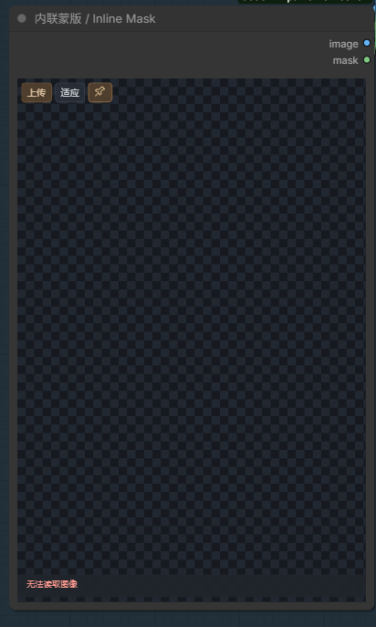
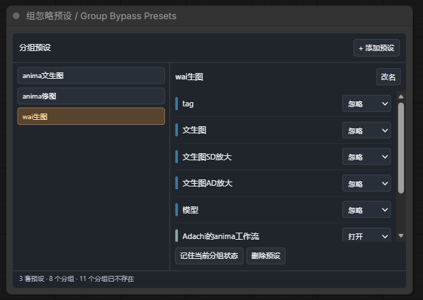
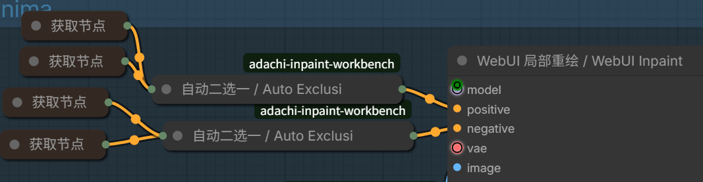
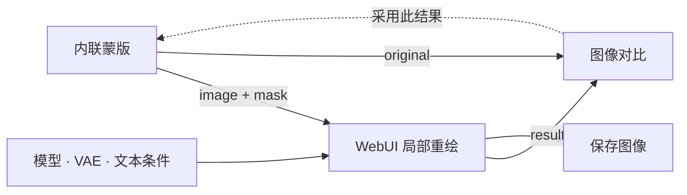

<div align="center">

# Adachi-Inpaint-Workbench

**绘制蒙版，局部重绘，对比结果，继续精修。**

直接在 ComfyUI 工作流内操作的重绘工作台，提供 WebUI 风格参数，以及分组预设、自动分支选择工具。

[English](README.md) · **简体中文**

[](LICENSE)
[](https://github.com/Comfy-Org/ComfyUI)
[](pyproject.toml)
[](https://github.com/adachi0130/Adachi-Inpaint-Workbench/actions/workflows/ci.yml)

[功能介绍](#功能介绍) · [安装](#安装) · [快速开始](#快速开始) · [节点一览](#节点一览) · [示例工作流](#示例工作流)


*保留工作台早期预览图；下方保留旧工具栏截图；v0.6 使用上传箭头、适应、图钉。*

</div>

## 为什么做这个工作台？

局部重绘时，常常需要在工作流、蒙版编辑器和生成结果之间来回切换。本插件把这段操作放回画布：直接在节点内涂蒙版，生成并对比结果，再把满意的图片作为下一轮原图，**保留已经画好的蒙版**继续精修。

| 工具 | 用途 |
| --- | --- |
| **内联蒙版 · Inline Mask** | 同一节点内涂蒙版，或裁切、重绘、双图层融合。 |
| **WebUI 局部重绘 · WebUI Inpaint** | 整图或蒙版区域采样，使用熟悉的重绘参数，按原图尺寸回贴结果。 |
| **图像对比 · Image Compare** | 鼠标划线对比、查看结果历史，一键采用后继续重绘。 |
| **组忽略预设 · Group Bypass Presets** | 保存各组的打开/忽略组合，一键切换工作流配置。 |
| **自动二选一 · Auto Exclusive Switch** | 自动输出唯一启用的分支，不用手动设置 switch。 |

界面支持英文和简体中文，跟随 ComfyUI 的语言设置。使用 ComfyUI 已有的 PyTorch、NumPy 和 Pillow，无需额外构建前端。

## 功能介绍

### 直接在工作流里画蒙版

在**内联蒙版**上传、拖入或粘贴原图，然后直接在节点画布上涂抹。蒙版在浏览器内更新，随工作流保存，不需要每画一笔都保存、加载磁盘文件。

- 支持画笔软边、硬度、不透明度、数位笔压感、临时擦除和形状工具。
- 顶部使用**↑ 上传、⛶ 适应、图钉**，右上角切换模式。图钉的悬停提示为「保持」：开启后图片持续适应并居中，普通滚轮控制工作流背景，`Ctrl` + 滚轮调整笔径，`Shift` + 滚轮调整硬度。
- 支持横向、纵向调整编辑区大小；图钉状态和节点尺寸都能随工作流保存。
- 连到 **WebUI 局部重绘**后，画笔工具和采样参数显示在重绘节点内，让图片编辑区保持简洁。画笔工具、蒙版内外和填充内容收进箭头折叠区，**撤销、重做、反转、全选、清空、导入蒙版、导出**整行始终显示；折叠状态随工作流保存。
- 放大工作流时限制显示画布的分配尺寸，并缓存原图/蒙版合成，减少反复重绘；实际保存的蒙版仍保持原图分辨率。

<details>
<summary>查看简洁工具栏</summary>

<p align="center">
  
</p>

*作者提供的工具栏示意图；截图中的原图预览尚未载入。*

</details>

### 一个节点内裁切、重绘和融合

在内联蒙版右上角选择**蒙版**或**裁切融合**。两种模式都通过图像对比节点的**采用此结果**回传图片；内联蒙版不再提供结果输入口。

裁切融合模式保留六组常用预设，宽高均为 64 的倍数，范围 512～2048（含两端）；可用交换按钮切换横竖方向，自定义尺寸按 64 像素递增。虚线框的左上角跟随鼠标，左键点击锁定，框外压暗。新选区的蒙版为空，需要自己在框内涂抹；画笔和形状操作限制在选区内，点击 **◌ 重绘蒙版**可返回编辑重绘范围。选区框为纯黑虚线；点击锁定时，相连 Inpaint 节点会自动填写裁片宽高，等同于点一次「使用原图宽高」。选区位置固定，支持反复重绘同一处。选定后仍可切换预设、交换横竖或修改自定义宽高；修改会自动取消当前选区，重新跟随鼠标定位，已有采用图层会先合并保留。

| 连线 | 用途 |
| --- | --- |
| `内联蒙版.image`、`mask` → `WebUI 局部重绘.image`、`mask` | 把裁片和重绘蒙版送去生成。 |
| `内联蒙版.image` → `图像对比.original`；`WebUI 局部重绘.image` → `图像对比.result` | 先对比裁片，再选择采用。 |
| `内联蒙版.full_image` → `保存图像.images` | 保存包含**已采用图层**的完整图像。 |

先生成，在**图像对比**中查看，满意后点击**采用此结果**，才会嵌回当前裁切位置；没有回接输入线，也不会生成后自动替换。比较结果使用重绘节点的 **image** 输出；`crop` 是采样画布，尺寸可能不同。[已连好的示例](examples/05-inline-crop-blend.json)。

采用后自动进入 **◐ 图层融合**：底层原图、上层重绘结果，画笔保留新图，按住 **Alt** 擦回原图，软笔刷可融合接缝。融合蒙版与重绘蒙版相互独立，同一区域继续生成会保留融合蒙版。**✓** 合并当前可见图层；在图片内**右键**先合并当前效果并取消选定，再左键选择新区域。**↶ 撤销**位于 ✓ 右边，可撤销当前重绘蒙版或融合蒙版的涂抹。没有裁切版本列表。批量生成时，在图像对比中选中想要的结果再采用；换到其他选区后，带有旧选区标记的结果会拒绝回贴，避免贴错位置。

### 整图重绘与蒙版区域重绘

| 采样区域 | 工作方式 |
| --- | --- |
| **整图范围** · `whole_image` | 将整张原图调整到采样尺寸，生成后通过蒙版合成回原图。 |
| **仅蒙版区域** · `only_masked` | 按蒙版边界截取区域，加入 padding 和宽高比所需的上下文，采样后回贴到原位置。 |

两种模式最终输出的 `image` 都保持**原图尺寸**。采样宽、高独立设置；**使用原图宽高**按钮可一键填写，并按采样器要求对齐到 8 的倍数。

面板提供蒙版内/外、原图像素/填充/潜空间噪声/空白潜空间、重绘幅度、采样器、调度器、步数、CFG 和种子。高级设置包括蒙版模糊、扩张、额外羽化、批次数量和可选 Refiner。

### 对比结果，采用后继续精修

鼠标移入**图像对比**：**左边是重绘结果，右边是原图**；移开后显示完整结果。分隔线保持细线，图片持续适应编辑区，滚轮作用于工作流背景。

同一轮编辑中的结果会累计保存并默认选中最新一张，每张结果对应当时的原图；重复的预览通知不会重复计数。

点击**采用此结果**，把选中的图片回填为内联蒙版的新原图，同时保留蒙版和当前会话中的撤销/重做记录。结果列表立即回到 **1/1**，下一次生成开启新一轮。采用失败时保留原列表；采用操作不会自动开始生成。

### 一键切换整套分组配置

为自己的工作流保存多套组合，例如文生图、修图、不同模型、ControlNet、放大等分支的打开/忽略状态。



左侧点选预设，右侧配置各组**打开 / 忽略 / 保持当前**，也能通过节点右键菜单应用。预设随工作流保存，不需要连线，也不依赖第三方组控制节点。已删除的组会显示提示；分组重叠时，较小组的设置优先。

### 自动使用剩下的一路输入

将两路备选输入连接到**自动二选一**，忽略其中一路后，另一条有效分支自动流向共同输出，无需手动切换 `switch`。



可用于提示词条件、字符串、图像、蒙版、模型、潜空间等数据；两路输入应为同一类型。两路都启用或都不可用时会报错，不会擅自优先选择 A。

支持 KJNodes 的 Get/Set 和重路由节点。**两个 Get 可以一直开启**：忽略其中一路对应的 Set 或上游源节点，就会停用那条分支。请求带有工作流信息时，后端也会核对已保存的子图输出；执行请求中仍存在相应源节点时，可恢复丢失的有效连接。

## 安装

### Git 安装

在 `ComfyUI/custom_nodes` 目录运行：

```bash
git clone https://github.com/adachi0130/Adachi-Inpaint-Workbench.git
```

**完整重启 ComfyUI，再按 `Ctrl+F5` 强制刷新网页**，macOS 可用 `Cmd+Shift+R`。在节点菜单搜索 `Inline Mask`、`WebUI Inpaint` 或 `Adachi`。

### 其他安装方式

- **ComfyUI Manager：**如果当前版本提供 Git URL 安装，可以填入本仓库地址。Git URL 安装与能否在 Manager 搜索索引中找到是两回事，收录说明见[发布文档](registry/README.md)。
- **ZIP：**[下载仓库压缩包](https://github.com/adachi0130/Adachi-Inpaint-Workbench/archive/refs/heads/main.zip)，解压后放到 `ComfyUI/custom_nodes/Adachi-Inpaint-Workbench/`，保留完整的 `web/`、`backend.py` 和 `__init__.py`。
- **Windows 安装脚本：**在解压后的插件目录运行以下命令，路径指向包含 `main.py` 的 ComfyUI 目录：

```powershell
powershell -ExecutionPolicy Bypass -File .\install.ps1 -ComfyUIPath "D:\ComfyUI_windows_portable\ComfyUI"
```

脚本会将已有安装备份到 `user/adachi-workbench-backups/`，不会自动重启 ComfyUI。

Git 安装用户可在插件目录运行 `git pull` 更新，然后重启 ComfyUI 并刷新网页。`custom_nodes` 中只保留一份本插件，避免重复加载。

## 快速开始

1. 将 [01-inline-inpaint.json](examples/01-inline-inpaint.json) 拖入 ComfyUI，选择兼容的 checkpoint；也可以连接现有工作流的模型、VAE 和文本条件。
2. 在**内联蒙版**上传图片，涂出需要修改的部分。**白色重绘、黑色保留**，橙色只是界面叠加显示。
3. 编辑上游节点的正面/负面提示词，在 **WebUI 局部重绘**里设置采样区域、宽高和重绘幅度，运行工作流。
4. 查看对比结果，满意时点击采用，将它作为新原图，保留蒙版继续修改。



### 必要连线

| 从哪里 | 连到哪里 |
| --- | --- |
| `内联蒙版.image` / `mask` | `WebUI 局部重绘.image` / `mask` |
| 模型 / VAE / 正面条件 / 负面条件 | `WebUI 局部重绘`对应输入 |
| `内联蒙版.image` | `图像对比.original` |
| `WebUI 局部重绘.image` | `图像对比.result`，以及需要时的 `保存图像.images` |

Refiner 输入是可选项。只有需要兼容的第二阶段模型时才连接，否则留空即可。

## 节点一览

分类为 **Adachi-Inpaint-Workbench**。组忽略预设是前端控制节点，其余六个为用户使用的后端节点；

| 节点 | 用途 | 输出 |
| --- | --- | --- |
| **内联蒙版 · Inline Mask** | 普通蒙版或裁切重绘、双图层融合 | `image`、`mask`、`full_image` |
| **WebUI 局部重绘 · WebUI Inpaint** | 一体化准备、采样、合成 | `image`：完整合成图；`crop`：采样画布；`mask`：采样蒙版 |
| **图像对比 · Image Compare** | 预览、对比、采用结果 | `image`：原样传递结果批次 |
| **组忽略预设 · Group Bypass Presets** | 应用已保存的组状态 | 无需连线 |
| **自动二选一 · Auto Exclusive Switch** | 传递唯一启用的输入 | `output`：被选中分支的数据类型 |
| **重绘准备 · Inpaint Prepare** | 为自定义采样流程裁剪、调整图像和蒙版 | `pixels`、`mask`、`context` |
| **重绘合成 · Inpaint Composite** | 将局部解码结果回贴到原图 | `image` |

模块化流程可使用 `Prepare.pixels → VAE 编码 → 设置潜空间噪声蒙版 → 采样器 → VAE 解码 → Composite`。`Prepare.mask` 连接噪声蒙版节点，**务必把 `Prepare.context` 连到 `Composite.context`**，详见[模块化示例](examples/02-modular-inpaint.json)。

## 画布快捷操作

| 操作 | 快捷键或控件 |
| --- | --- |
| 画笔 / 橡皮擦 / 矩形 / 套索 | `B` / `E` / `R` / `L` |
| 临时橡皮擦 | 按住 `Alt`，松开后恢复之前的工具 |
| 调整笔径 | `Ctrl` + 滚轮，或 `[` / `]` |
| 调整硬度 | `Shift` + 滚轮 |
| 取消裁切选定 | 图片内右键，再左键选择新区域 |
| 撤销 / 重做 | `Ctrl+Z` / `Ctrl+Shift+Z`，或 `Ctrl+Y` |
| 未固定时的图片缩放 / 移动 | 滚轮 / 空格拖动、中键拖动，或移动工具 `H` |
| 保持图片适应 | 点击「适应」旁的图钉，再点一次解除 |
| 调整编辑区高度 | 拖动底部 `↕` 手柄 |

画笔面板还提供反转、全选、清空、PNG 蒙版导入/导出、原图/蒙版/叠加视图和**原图嵌入工作流**。叠加不透明度只影响显示。鼠标在按钮、参数区滚动时控制外部工作流；从工作流背景开始的连续滚轮手势，移入图片后仍控制工作流。

## 示例工作流

将对应 JSON 拖入 ComfyUI：

| 示例 | 内容 |
| --- | --- |
| [01 · 内联局部重绘](examples/01-inline-inpaint.json) | 完整绘制与重绘流程，需要自行选择兼容模型。 |
| [02 · 模块化重绘](examples/02-modular-inpaint.json) | Prepare / Composite 配合常规编解码与采样节点。 |
| [03 · 分组预设](examples/03-group-presets.json) | 使用图像分支演示预设切换，不需要模型。 |
| [04 · 自动二选一](examples/04-exclusive-switch.json) | 分组预设控制两路输入，不需要模型。 |
| [05 · 内联裁切融合](examples/05-inline-crop-blend.json) | 同一编辑器裁切、接收结果和输出完整回贴图，需要选择模型并上传原图。 |

## 兼容性与重要行为

- **静态图片：**支持常规四维 `[B,C,H,W]` 和单帧五维 `[B,C,1,H,W]` 图像潜空间，包括 Anima 使用的 Wan 衍生 VAE 路径；需提供该模型配套的 VAE 和文本条件，不是多帧视频重绘。
- **Anima：**普通带蒙版图生图请关闭 **inpaint_model / 专用重绘模型**。该选项用于专用 inpaint 架构，并非画了蒙版就需要开启。
- **原图尺寸：**两种采样区域最终都按原图尺寸合成；如果要目标采样尺寸的图片，使用 `crop` 或另接调整尺寸节点。
- **裁切图层：**选区和融合蒙版会保存到工作流，最新重绘图层引用 `input/adachi-inpaint-layers/` 中的图片。跨机器移动尚未合并的编辑时需带上这张图，或先合并图层再嵌入原图。
- **分享工作流：**蒙版会写入 JSON。原图默认只存 `input/` 下的相对路径，开启**原图嵌入工作流**才会把图片也写进去，文件会变大。加载工作流、上传图片、切换模式或勾选嵌入时，如果浏览器草稿空间不足，插件先保存一份完全相同的原图到 input 图片目录，再改用文件引用，保留蒙版、图层和笔画记录。若确实要把大图嵌入 JSON，可先关闭 ComfyUI 的浏览器工作流持久化，再勾选嵌入；导出文件不受浏览器草稿限额影响。若当前页面已经每次操作都提示草稿失败，请先按 **Ctrl+S** 保存，再按 **Ctrl+F5** 刷新一次，重置 ComfyUI 本页已停用的草稿状态。
- **采用结果：**结果尺寸必须与原图一致，才能保留蒙版坐标。撤销/重做记录在本次会话中保留；保存重开保留蒙版，不保存逐笔命令历史。
- **临时预览：**对比历史保存的是预览引用，ComfyUI 清理临时文件后可能失效；已采用的原图保存在 `input/adachi-inpaint/`。
- **功能范围：**这是独立实现的 WebUI 风格工具，不保证与 WebUI 像素、脚本和扩展行为完全一致；额外软边羽化并非 WebUI 的完整 Soft Inpainting 算法。

<details>
<summary>采样、填充与批次细节</summary>

- 采样宽高使用 8 的倍数。padding、模糊和蒙版扩张以原图像素计量；模糊/扩张会改变有效蒙版边界，有效蒙版为零的像素保持不变。
- `mask_mode=outside` 会先反转涂抹区域，再进行蒙版处理。
- `resize_mode` 控制整图采样的调整方式；仅蒙版区域使用保留完整蒙版的比例变换，也适用于蒙版碰到图像边缘的情况。
- 填充模式包括**原图像素、周边颜色填充、潜空间噪声、空白潜空间**。潜空间模式属于一体化重绘节点；模块化 Prepare 只处理图像和蒙版。
- 空蒙版或 `denoise=0` 会跳过 VAE 和采样。`batch_size` 表示每张原图生成的变体数，不是 ComfyUI 队列次数。
- 模块化多原图批次需按原图分组变体，例如 `A,A,B,B`，而非交错的 `A,B,A,B`。
- 可选 Refiner 使用 `refiner_model` 与 `refiner_switch`；`0.8` 表示最后 20% 步骤使用 Refiner，建议提供兼容的专用文本条件。设为 `1` 只用基础模型，`0` 只用 Refiner。
- 输入限制为单文件 64 MiB、单图 3200 万像素、单边 16384 像素。大图绘制与 PNG 编码速度仍取决于浏览器内存和硬件。

</details>

## 排错与开发

**更新后还是旧界面？** 完整重启 ComfyUI，再强制刷新网页。Python 后端修改不能仅靠刷新网页加载。

**自动二选一提示没有有效输入？** 检查真正的上游源节点和对应 Set，不能只看 Get。将二选一放在受控分组之外。若其他集成仍会丢掉子图输出，可以先把 CLIP 编码器放到子图外。反馈时请附上工作流、插件/前端版本和完整错误；当前错误会显示前端、工作流与执行输入的状态标记。

**打开别人的工作流后图片丢失？** 按相对路径补齐原图，或请对方开启原图嵌入后再保存。临时对比预览失效则需要重新生成。

运行 CPU 回归测试：

```bash
python -m unittest discover -s tests -v
node --experimental-default-type=module tests/test_exclusive_routes.mjs
node --experimental-default-type=module tests/test_compare_history.mjs
```

已测试配置和范围见[验证记录](VERIFICATION.md)，版本变化见[更新日志](CHANGELOG.md)，恢复旧版本见[回滚说明](ROLLBACK.md)。模型家族和实际画质测试并非全覆盖。

## 致谢与许可证

由 **Adachi / 安达** 制作，采用 [MIT 许可证](LICENSE)。

基于 [ComfyUI](https://github.com/Comfy-Org/ComfyUI) 构建，重绘交互参考 WebUI，鼠标划线对比体验参考 [rgthree-comfy](https://github.com/rgthree/rgthree-comfy)。代码由本仓库独立实现，这些项目不作为捆绑依赖。

欢迎通过 [Issues](https://github.com/adachi0130/Adachi-Inpaint-Workbench/issues) 反馈问题、分享工作流用法。
